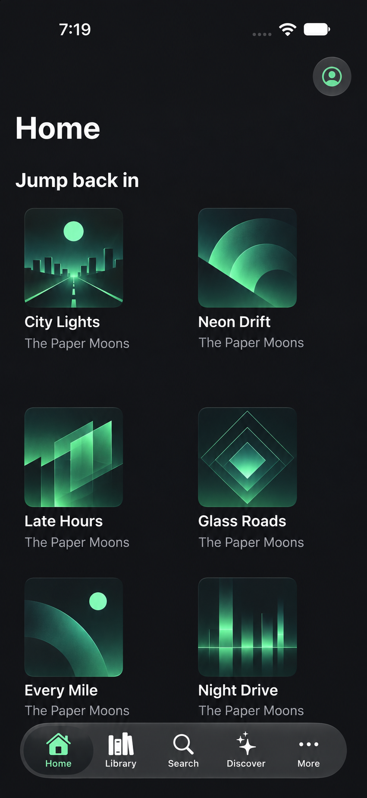
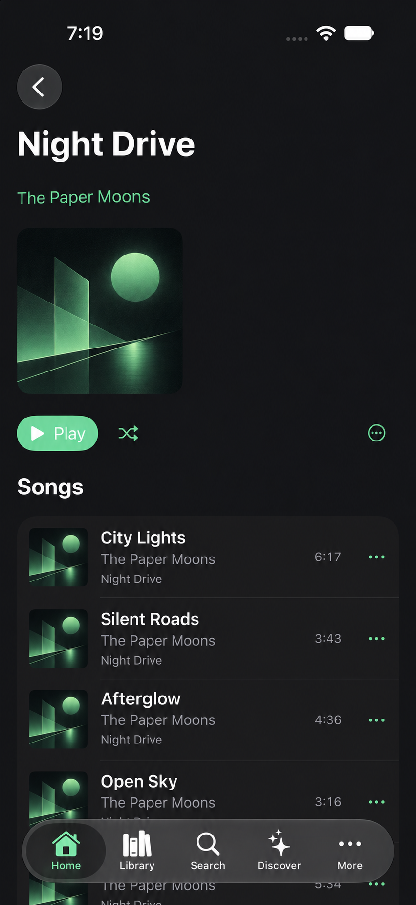
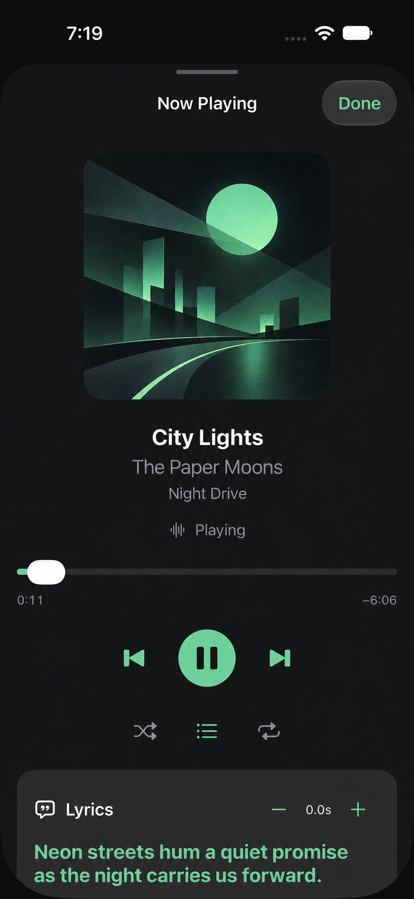
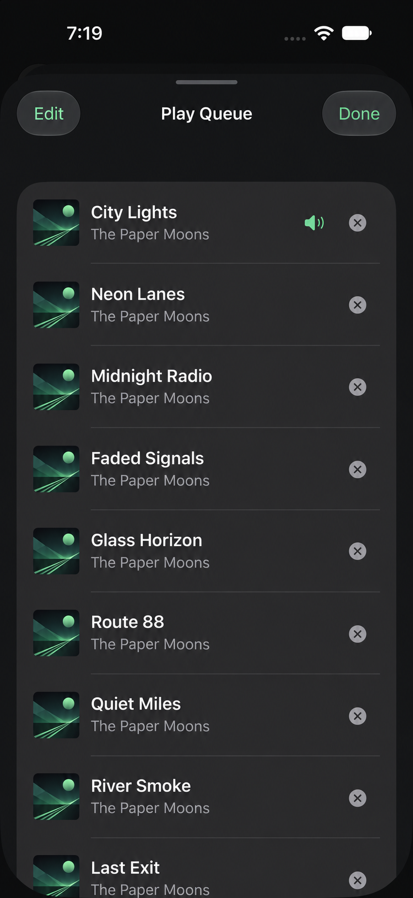

# Downtify iOS

Downtify is a SwiftUI iPhone and iPad app targeting iOS 17 and later. It includes server connection and library flows, local library sync, and a playback experience with a persistent queue, queue editing, shuffle/repeat, and background and lock-screen controls. Automated tests use synthetic fixtures; the checklist below calls out manual simulator work that still needs a reachable server.

## Screenshots

<p>
  
  
  
  
</p>

## Build and test on a Mac

Open `Downtify.xcodeproj` with the installed Xcode version. Install an iOS simulator runtime in Xcode Settings, choose the shared **Downtify** scheme and an iPhone or iPad simulator, then use **Product → Run** and **Product → Test**. Simulator builds do not need a development team.

For command-line validation, use an available simulator UDID from the listing.

```sh
xcrun simctl list devices available
xcodebuild -project Downtify.xcodeproj -scheme Downtify -destination 'platform=iOS Simulator,id=<SIMULATOR_UDID>' -derivedDataPath /tmp/DowntifyDerived clean build-for-testing
xcodebuild -project Downtify.xcodeproj -scheme Downtify -destination 'platform=iOS Simulator,id=<SIMULATOR_UDID>' -derivedDataPath /tmp/DowntifyDerived test-without-building
```

## Simulator checklist

Run the test suite above for deterministic playback, persistence, network-contract, and presentation behavior. Then use **Product → Run** to review the complete user flow:

- Connect to a reachable server, sign in, refresh the library, and start a track.
- Open Now Playing; verify play/pause, seek, previous/next, shuffle, and all three repeat modes.
- Open Play Queue; verify the current item and upcoming items, select an upcoming item, remove an item (including one duplicate track occurrence), and reorder upcoming entries.
- Confirm queue edits and the selected occurrence survive relaunch, and confirm lock-screen controls/metadata while audio plays.
- Try sign out and reconnect, including the permission and error states relevant to the server.

Manual server-backed playback, persistence across an app relaunch, and lock-screen behavior require a reachable server and device/simulator interaction; automated fixture tests alone do not verify these end-to-end steps.

## Server instance

You can test the app with your own reachable Downtify server instance.

## License

This project is licensed under the [GNU General Public License version 3](LICENSE), matching the Android reference app.

## Boundaries and platform decisions

- **App** owns composition. The SwiftUI App holds a single container across scenes. Add concrete adapters at this boundary as their features land and pass feature dependencies through initializers. Presentation owns scene and main-actor UI state. Future playback and transfer coordinators should be process-scoped, with their mutable state isolated from views.
- **Presentation** receives domain values and feature protocols as those are introduced. **Network/V1** owns wire names and decoding. Transport and DTO-to-domain mapping belong at the network and repository boundaries. Add **Domain**, **Data** and **Playback** groups when they have concrete responsibilities.
- Use system SQLite through `SQLite3` for the synced library and durable operations. Keep the connection behind an isolated store. Apply ordered schema migrations in transactions and test upgrades from supported versions. A failed migration should preserve the database and surface a recovery state. Only explicitly rebuildable data can be discarded and resynced.
- Put durable data and offline media in Application Support, separate from purgeable stream and artwork caches. Exclude redownloadable media and database state from backup while preserving durable user-created state. Use complete-until-first-user-authentication file protection where background access after unlock is required and complete protection for foreground-only sensitive files. Protect database sidecars alongside the database. Store the device token in Keychain with after-first-unlock, this-device-only accessibility if background authentication is required.
- Use the SwiftUI scene lifecycle for foreground refresh and state persistence as those features land. Add background modes and any delegate callbacks with the playback and transfer implementations that require them.

## Project documents

- [Porting plan](docs/PORTING_PLAN.md)
- [Android parity audit](docs/ANDROID_PARITY_AUDIT.md)
- [Search, Finder and Discover parity audit](docs/WEBUI_PARITY_AUDIT.md)
- [Agent handoffs](agents/README.md)
